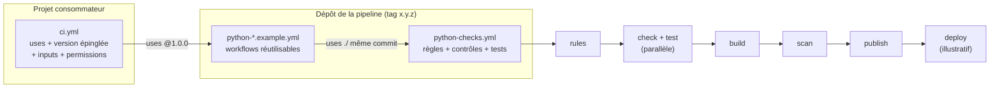

# pipeline-python-centralisee-portfolio

[](https://github.com/JulienMilon-DevSecOps/pipeline-python-centralisee-portfolio/actions/workflows/ci.yml?query=branch%3Amain)
[](https://github.com/JulienMilon-DevSecOps/pipeline-python-centralisee-portfolio/releases)

Version publique et **allégée** d'une pipeline GitHub Actions centralisée pour
projets Python (packages et API conteneurisées). Elle montre l'architecture et
les conventions ; la version complète, utilisée par mes projets, reste privée.
Une version GitLab CI/CD de la même pipeline existe aussi.

## Le problème

Chaque projet Python finit avec son propre workflow CI : copié d'un projet
voisin, modifié à la main, jamais tout à fait à jour. Résultat :

- des contrôles de sécurité présents ici, oubliés là ;
- une correction à reporter dans N dépôts ;
- aucune vue claire de « qui utilise quelle version de quoi ».

## Le principe : une usine à pipelines

Les jobs sont écrits **une fois**, dans un dépôt dédié, versionné comme un
logiciel. Chaque projet consommateur n'écrit que quelques lignes : il appelle
un **workflow réutilisable** à une **version épinglée** et ne déclare que ce
qui lui est propre.

```yaml
# .github/workflows/ci.yml d'un projet consommateur
on:
  push:
    branches: ["**"]
    tags: ["V-*"]
permissions:
  contents: read
  packages: write
jobs:
  pipeline:
    uses: my-org/pipeline-python-factory/.github/workflows/python-docker.example.yml@1.0.0
    with:
      python_version: "3.13"
      pytest_cov_source: app
    secrets: inherit
```



Les mécanismes utilisés (détaillés dans [docs/architecture.md](docs/architecture.md)) :

- `workflow_call` avec **inputs typés**, appelé à une version épinglée ;
- une **brique commune** (`python-checks.yml`) appelée par les deux pipelines ;
- un job `rules` qui centralise les déclencheurs et valide les inputs ;
- des **ancres YAML** pour partager une étape entre jobs ;
- droits du `GITHUB_TOKEN` au plus juste, job par job ;
- actions tierces épinglées par **SHA**, images d'outils par **digest**.

## Étapes

| Étape     | Jobs de la vitrine                         | Rôle                                         |
|-----------|--------------------------------------------|----------------------------------------------|
| `rules`   | `rules`                                    | type de ref (branche, release, déploiement), validation des inputs |
| check     | `secret-detection`, `ruff`                 | secrets dans l'historique, lint + formatage  |
| test      | `pytest`, `dependency-scan`                | tests + couverture, vulnérabilités Python    |
| build     | `build-package` / `docker-build`           | wheel + sdist, ou image (sans push hors tag) |
| scan      | `trivy-scan`                               | vulnérabilités de l'image                    |
| publish   | `publish-pypi` / `publish-image`           | PyPI / TestPyPI, ou tag `latest` après scan  |
| deploy    | `deploy-compose` / `deploy-helm`           | **exemple illustratif**, interchangeable     |

Contrôles et tests tournent en parallèle ; le build n'a lieu que si **tous**
ont réussi, la publication que si le scan a réussi.

## Contenu du dépôt

```text
.github/workflows/
  python-checks.yml            brique commune : rules, secret-detection, ruff, pytest, dependency-scan
  python-package.example.yml   pipeline package (build, PyPI / TestPyPI)
  python-docker.example.yml    pipeline image (build, scan, publish, deploy illustratif)
  ci.yml                       CI de ce dépôt
examples/
  consumer-package/ci.yml      workflow d'un package consommateur
  consumer-api/ci.yml          workflow d'une API Docker consommatrice
  sample-app/                  mini API FastAPI testée par la CI de ce dépôt
docs/                          architecture, contrat des inputs, processus de release
```

La CI de ce dépôt applique `python-docker.example.yml` à `examples/sample-app`
(lint, tests, analyse des dépendances, build de l'image sans push) et passe
`yamllint` et `actionlint` sur tout le YAML : le badge ci-dessus prouve que les
fichiers publiés s'exécutent.

## Utilisation réelle

La pipeline complète est utilisée par des projets consommateurs réels : un
package Python publié sur PyPI et une API FastAPI livrée en image Docker. Leurs
workflows ont servi de base à `examples/consumer-package/` et
`examples/consumer-api/`.

## Ce qui n'est pas dans la vitrine

Ce dépôt montre la structure, pas l'intégralité. La version privée ajoute
d'autres contrôles, une chaîne d'approvisionnement plus complète, des modes
d'installation et de publication supplémentaires, et l'outillage qui la teste
et la maintient. Les jobs présentés ici sont volontairement réduits à
l'essentiel.

Le déploiement (`deploy-compose`, `deploy-helm`) est un **exemple générique** :
il montre qu'une même étape peut s'appuyer sur Docker Compose ou sur Helm, sans
être un template de production.

## Versioning

- Version sémantique `x.y.z`, tags sans préfixe, jamais déplacés.
- Chaque version a son entrée dans [CHANGELOG.md](CHANGELOG.md) et sa GitHub Release.
- Les projets consommateurs épinglent une version ; la montée de version est
  une PR, avec les notes de migration du CHANGELOG.

Détails : [docs/release-process.md](docs/release-process.md). Inputs :
[docs/inputs.md](docs/inputs.md).

## Auteur

Auto-entreprise Julien MILON (DevSecOps).

Ce projet a été codéveloppé avec l'aide d'outils d'IA, sous ma direction
complète : architecture, choix techniques, relecture et validation de chaque
fichier.

## Licence

[MIT](LICENSE). La licence couvre cette vitrine uniquement, pas la version
complète de la pipeline.

---

## English summary

A public, **lightweight** showcase of a centralized GitHub Actions pipeline for
Python projects (packages and containerized APIs). The full version is private;
a GitLab CI/CD edition of the same pipeline also exists.

- **Principle:** jobs are written once in a dedicated, versioned repository.
  Consumer projects call a **reusable workflow** at a **pinned tag**
  (`uses: …@1.0.0`) with typed `inputs`, and only declare what is specific to them.
- **Building blocks:** a shared `python-checks.yml` called by both pipelines, a
  `rules` job that owns triggers and validates inputs, YAML anchors for shared
  steps, least-privilege `GITHUB_TOKEN` permissions per job, third-party actions
  pinned by SHA and tool images by digest.
- **Proof:** this repository's own CI runs the example Docker pipeline against
  `examples/sample-app` (lint, tests, dependency audit, image build without
  push) and runs yamllint and actionlint on every YAML file.
- **Releases:** SemVer tags `x.y.z`, never moved, each with a CHANGELOG entry and
  a GitHub Release; consumers upgrade through a pull request.
- **Deployment:** the deploy stage is a generic example showing that Docker
  Compose and Helm are interchangeable, gated by GitHub environments; it is not
  a production template.

See `docs/` for architecture, the input contract and the release process.

Author: Julien MILON, DevSecOps (French sole proprietorship, « auto-entreprise »).
Co-developed with AI tools, fully directed by the author (architecture,
technical choices, review and validation of every file).
